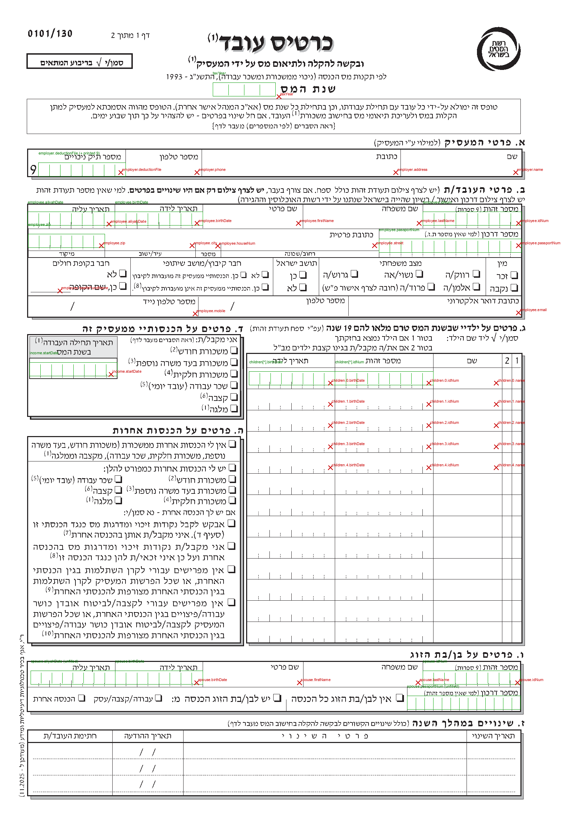
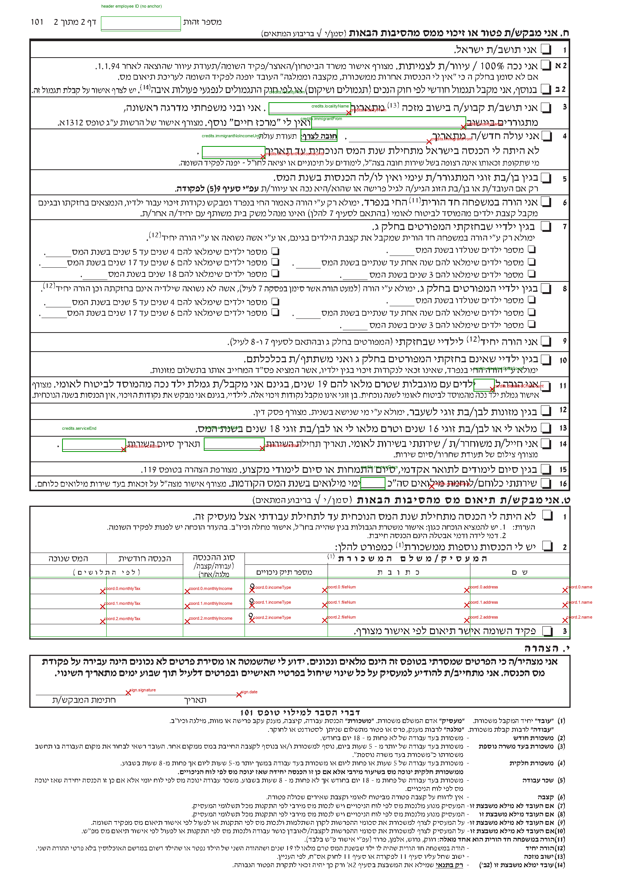
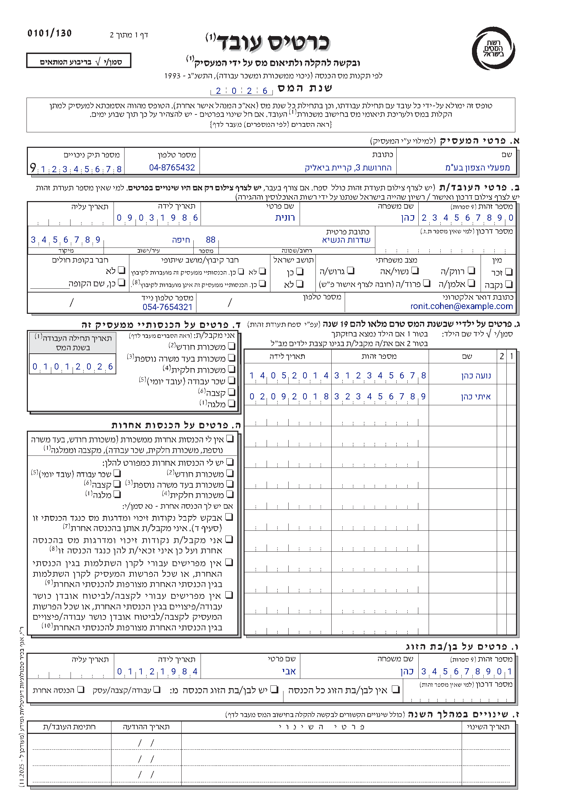
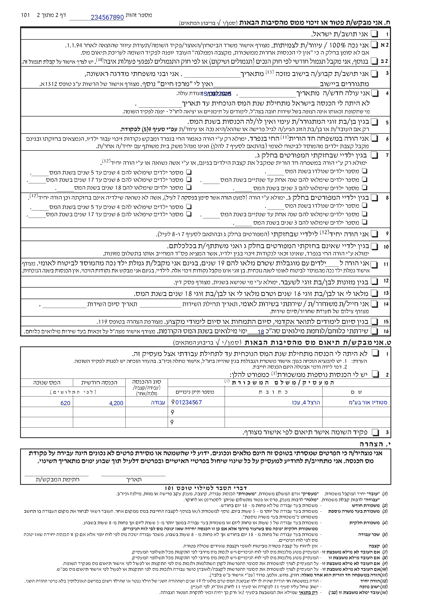

# PDF 101 slot map

The official 101 is **not** a set of free writing lines. Most numeric facts live
in printed **cell grids** — 4 to 13 small cells delimited by 4 pt tick marks that
look like commas/apostrophes. The tax year, both deduction-file numbers, every ID,
every date, the ZIP, the passport number and the work-start date all have their
own grid. Before 2026-10-31 the overlay (`app/pdf/fields.ts`) printed one
right-aligned string per field, so the digits landed between cells, spilled into
a neighbouring label, or detached the pre-printed deduction-file 9 from the rest
of the number.

This node is the measured inventory: **every data piece → its exact printed
space**, the anchors that were wrong, and the cell renderer that replaced them.
The geometry below is what the generator now emits into `anchors.json`.





Coordinates are **PDF points from the top-left**, the same convention as
`app/pdf/anchors.json`. The source artifact is pinned by SHA-256
`bf4f11b0…d7d633` (edition `0101/130`, updated `11.2025`).

## Method (repeatable)

1. `bun run tools/pdf/dump-text.ts <page> [y0] [y1]` — text items with their
   baseline (`y` from top), x, width and height.
2. `python3 tools/pdf/extract-cells.py` — walks the content stream, tracks the
   `q … cm … Q` translations, and clusters the short vertical strokes (the
   ticks) into rows with their x positions, lengths and gaps.
3. `python3 tools/pdf/audit-slots.py` — draws the measured grids (green) and the
   current `anchors.json` text anchors (red) on a 200 dpi raster. The two images
   above were captured before the fix; rerun the script to compare a future map.
4. `bun run tools/pdf/probe-cells.ts` — the independent prototype that drew the
   target layout (hand-coded grids, not the production map).

**Key extraction rule.** A grid is *tick-derived*, not box-derived: take the
first tick − one step and the last tick + one step. Several columns have an
inset double border (the spouse row and the children table, for example), so
using the printed box edges shifts every cell by 1–3 pt. Ticks are 4.1–4.2 pt
tall; the day/month separators in date grids are the same stroke drawn 6.9 pt
tall.

## Page 1 — the grids

`x0..x1` is the writing area; cells are equal width unless `groups` says
otherwise. `groups: 2,2,4` means the form prints a taller separator after the
2nd and 4th digit (dd/mm/yyyy).

| slot | field id(s) | x0 .. x1 | cells | groups | baseline (top) | pre-printed | old anchor | pre-fix behaviour |
| --- | --- | --- | --- | --- | --- | --- | --- | --- |
| Tax year | `taxYear` (meta) | 220.41 .. 285.31 | 4 | — | 98.2 | — | `xRight 289 / y 100` | string; anchor is **3.7 pt right of the box** and the baseline sits on/under the rule |
| Employer deduction file | `employer.deductionFile` | 39.89 .. 130.29 | 8 | — | 180.3 | **`9`** at x 30.50–38.42, baseline 180.34, size 18 | `xRight 125 / y 178.3` | one string of the 8-digit tail (the leading 9 is stripped in `fields.ts`); still ignores the 8 cells |
| Employee aliyah date | `employee.aliyahDate` | 28.69 .. 119.01 | 8 | 2,2,4 | 231.0 | — | `xRight 113 / y 231.8` | string with `/` over the ticks |
| Employee birth date | `employee.birthDate` | 119.01 .. 210.00 | 8 | 2,2,4 | 231.0 | — | `xRight 204 / y 231` | string with `/` over the ticks |
| Employee ID | `employee.idNum` | 438.11 .. 540.21 | 9 | — | 231.0 | — | `xRight 537.1 / y 231` | string; cover only the right half of the grid |
| ZIP | `employee.zip` | 29.23 .. 108.44 | 7 | — | 254.0 | — | `xRight 105 / y 254` | string; 5- and 7-digit values ignore the cells |
| Employee passport | `employee.passportNum` | 392.50 .. 540.21 | 13 | — | 259.8 | — | `xRight 537.1 / y 254` | string; **7.3 pt too high** — drawn above the tick row |
| Work start date | `income.startDate` | 30.75 .. 121.39 | 8 | 2,2,4 | 387.0 | — | `xRight 115 / y 387` | string with `/` over the ticks |
| Child birth date (×5) | `children[r].birthDate` | 258.01 .. 346.91 | 8 | 2,2,4 | 396.2 + 21.9·r | — | `xRight 342 / y 396.2+21.9r` | string |
| Child ID (×5) | `children[r].idNum` | 346.91 .. 448.81 | 9 | — | 396.2 + 21.9·r | — | `xRight 444 / y 396.2+21.9r` | string |
| Spouse aliyah date | *no app field* | 31.87 .. 119.33 | 8 | 2,2,4 | 706.0 | — | — | **not printed** (the form asks for it) |
| Spouse birth date | `spouse.birthDate` | 119.33 .. 209.97 | 8 | 2,2,4 | 706.0 | — | `xRight 203.7 / y 706` | string |
| Spouse ID | `spouse.idNum` | 437.76 .. 539.23 | 9 | — | 706.0 | — | `xRight 536 / y 706` | string |
| Spouse passport | *no app field* | 421.65 .. 538.98 | 13 | — | 731.9 | — | — | **not printed** |

The table's `x0..x1` are the **printed box/column edges** for orientation. The
generated `anchors.json` uses the tick-derived bounds from the next section; they
can differ by up to 1.6 pt (the children date grid starts at 256.4, not the
258.0 inner border). `anchors.json` is the source of truth at runtime.

Notes from the measurements:

- **Deduction file.** The 9 is a *pre-printed leading digit*, not a hint: its
  right edge (38.42) is 1.5 pt left of the first writing cell (39.89), and the
  eight remaining cells are exactly the eight digits left after the leading 9.
  The validator already requires `^9\d{8}$`
  (`app/form/validators.ts`, `deductionFileNumber`), so the PDF must print
  `value.slice(1)` into the eight cells — not the whole string.
- **Dates.** Page 1 has no printed `/`. The day/month/year boundary is the
  taller 6.9 pt tick. Print the eight digits only; do **not** draw the `/`
  characters or they will cross the separators (this is visible in the current
  samples).
- **Passport.** 13 cells is more than an Israeli passport needs; it is sized
  for foreign travel-document numbers. Fill from the left, leave trailing cells
  empty. The schema allows 20 characters, so a value longer than 13 needs the
  string fallback.
- **ZIP.** The form prints 7 cells (current postal code). The app accepts the
  legacy 5-digit code too; decide whether a short code fills the leftmost five
  cells or the rightmost five (see open questions).
- **Tax year.** The four cells are 16.2 pt wide and only 8 pt tall. Baseline
  98.2 keeps the glyph body inside the box; the current 100 sits on the rule.

## Page 1 — the free lines (no cells)

These are open boxes/lines. Right-aligned text below the label is correct; the
current anchors are fine.

| slot | field id | cell (x0 .. x1) | anchor | verdict |
| --- | --- | --- | --- | --- |
| Employer name | `employer.name` | 414.90 .. 540.42 | `xRight 534 / y 178.3` | ok |
| Employer address | `employer.address` | 209.00 .. 414.90 | `xRight 410 / y 178.3` | ok |
| Employer phone | `employer.phone` | 130.29 .. 209.00 | `xRight 204 / y 178.3` | ok |
| Employee first name | `employee.firstName` | 210.00 .. 313.89 | `xRight 308.9 / y 231` | ok |
| Employee last name | `employee.lastName` | 313.89 .. 438.11 | `xRight 434 / y 231` | ok |
| Street | `employee.street` | 228.79 .. 392.50 | `xRight 388 / y 254` | ok |
| House number | `employee.houseNum` | 202.61 .. 228.79 | `xRight 225.5 / y 254.4` | ok |
| City | `employee.city` | 108.44 .. 202.61 | `xRight 199 / y 254` | ok |
| Mobile | `employee.mobile` | 28.69 .. 205.42 | `xRight 202 / y 324.4` | ok |
| Email | `employee.email` | 360.96 .. 540.21 | `xRight 537 / y 323.4` | ok |
| Health fund name | `employee.healthFundName` | short rule at 30 .. 62 | `xRight 62 / y 300.6` | ok |
| Employee landline | *no app field* | 205.42 .. 360.96 | — | **not printed** (the form has a line for it) |

The contact row also prints a `/` inside each phone field (x = 73.1 in the
mobile field, x = 238.8 in the landline field). These are not cell guides and do
not need to be honoured for the values we print today; note them before adding
the landline field.

The section ז change table has two date columns with printed `/` at
x = 144.79/157.71, rows at y = 780.63, 797.60, 813.88. The app collects no
change rows, so it prints nothing there.

## Page 1 — checkbox groups

The `MARK_RULES` in `app/pdf/fields.ts` were verified against the blank raster
and the three sample profiles; they land in the printed `o`/`q` box centres.
They are not part of this defect. The children table has no glyphs: the two
tick columns are the header numerals `1` and `2` centred in their cells.

## Page 2 — slots that are not ticks

Page 2 has **zero short tick grids** (the credit section is prose with
underline rules), but it repeats important data and has three pre-printed
leading 9s.

### Header

| slot | field | printed rule | anchor | verdict |
| --- | --- | --- | --- | --- |
| Employee ID on page 2 | `employee.idNum` (or passport) | x 95.66 .. 170.66, baseline/rule y 27.89 | **none** | **missing** — the page-2 header is blank in every export |

### Section ט coordination table

Columns are bounded by vertical rules (no ticks):

| column (RTL) | cell x0 .. x1 | old anchor | pre-fix behaviour |
| --- | --- | --- | --- |
| Name | 444.34 .. 538.63 | `xRight 534` | ok |
| Address | 309.84 .. 444.34 | `xRight 441` | ok |
| Deduction file | 231.34 .. 309.84 | `xRight 307` | prints the 8-digit tail right-aligned; the printed 9 stays detached at the left edge |
| Income type | 173.04 .. 231.34 | `xRight 238` | **6.7 pt too far right** — `עבודה` overlaps the printed 9 |
| Monthly income | 100.44 .. 173.04 | `xRight 177` | **4 pt too far right** — crosses the column rule |
| Tax withheld | 28.41 .. 100.44 | `xRight 97` | ok |

Each deduction-file cell pre-prints a **9** at x 235.75–241.03, baseline
557.29 + 14.2·r, size 12. As on page 1 it is the leading digit. Print the
trailing eight digits starting immediately after it (left-to-right), not the
whole nine-digit string right-aligned at the cell edge.

### Section ח prose blanks

| slot | field id | printed blank | old anchor | pre-fix behaviour |
| --- | --- | --- | --- | --- |
| Locality name | `credits.localityName` | rule 294.32 .. 440.32 @ 119.88 | `xRight 438 / y 119.9` | ok |
| Locality from | `credits.localityFrom` | rule 254.07 .. 331.62 @ 106.54 | `xRight 329.6 / y 106.5` | ok |
| Immigrant from | `credits.immigrantFrom` | rule 284.11 .. 318.64 @ 131.80 | `xRight 405.6 / y 133.9` | **wrong blank and wrong line** — 87 pt to the right, 2 pt below |
| No income until | `credits.immigrantNoIncomeUntil` | rule 190.97 .. 250.57 @ 147.89 | `xRight 248.6 / y 147.9` | ok |
| Service start | `credits.serviceStart` | rule 192.65 .. 249.86 @ 423.25 | `xRight 247.9 / y 423.2` | ok |
| Service end | `credits.serviceEnd` | rule 58.82 .. 118.87 @ 424.25 | `xRight 116.9 / y 424.2` | ok |
| Disabled child count | `credits.disabledChildCount` | text underline 447.50 .. 467.30 @ 367.50 | `xRight 465.2 / y 367.3` | ok |
| Reserve days | `credits.reserveDays` | text underline 340.90 .. 364.00 @ 460.50 | `xRight 408 / y 459.2` | **44 pt too far right** — lands under `מילואים`, not on the blank |
| Date | `sign.date` | rule 139.87 .. 227.96 @ 655.95 | `xRight 226 / y 655.9` | ok |
| Signature | `sign.signature` | box 36 .. 122 above the 34 .. 122 rule @ 655.95 | `xRight 121 / y 654` | ok |

The two wrong blanks share a trap: `credits.immigrantFrom` was measured from a
neighbouring label, and `credits.reserveDays` is a **text underline inside a
merged RTL text run**, not a vector rule. `pdfjs`'s `getTextContent()` returns
the whole line as one item, so the underscore glyphs cannot be located from the
text items; the raster pass is what found the 23 pt line. The build generator
must read these from the content-stream `005F` glyph run or from a raster scan,
not from the label anchor.

## Data pieces the PDF has, but the app does not print

These are outside the "put the number in its cell" defect, but they are part of
the same slot map and should be decided explicitly:

1. **Page-2 header ID** — every page of the official form identifies the
   employee. Missing today (highest priority; one anchor, no new data).
2. **Employee landline** — the contact row has a `מספר טלפון` cell; the schema
   only collects `employee.mobile`. Either collect it or accept the blank.
3. **Spouse aliyah date** — section ו has an 8-cell grid; the schema has no
   `spouse.aliyahDate`.
4. **Spouse passport** — section ו has a 13-cell grid (`למי שאין מספר זהות`);
   the schema has no spouse passport field.
5. **Change rows (section ז)** — four columns with `/`-separated dates; the app
   has no change model (a v1 scope decision, not a bug).
6. **Credit items 7/8 child counts** — six small counts per item, derivable
   from the `children` rows (birth date + custody + age at tax year). Currently
   left blank; this is a feature, not a placement bug.
7. **`coord.noIncomeUntil`, `credits.immigrantType`,
   `employee.passportCountry`, `other.source`** — intentionally not printed;
   this edition has no slot (see `app/pdf/README.md`).

## Defects found before the fix (in priority order)

1. `taxYear` is a 4-cell grid; the current anchor is outside it and uses a
   single string.
2. `employer.deductionFile` is 8 writing cells **after a pre-printed 9**; the
   current formatter already strips the 9 but prints the tail as one string, so
   it ignores the cells.
3. `employee.idNum`, `spouse.idNum`, `children[*].idNum` are 9-cell grids;
   strings cover only the right half.
4. Four date grids (`aliyah`, `birthDate`, `income.startDate`,
   `children[*].birthDate`) are written as `dd/mm/yyyy` strings over printed
   tick separators.
5. `employee.zip` is a 7-cell grid.
6. `employee.passportNum` is a 13-cell grid **and** its baseline is 7.3 pt too
   high.
7. The page-2 header ID is never printed.
8. `credits.immigrantFrom` is anchored to the wrong blank (x +87 pt, y +2 pt).
9. `credits.reserveDays` is anchored 44 pt right of the text underline.
10. The coordination table's `incomeType` / `monthlyIncome` anchors cross into
    the neighbouring cells by 4–7 pt.
11. The coordination table's deduction-file tail is right-aligned, so the
    printed 9 sits detached at the opposite edge of the cell.

## Implementation (landed 2026-10-31)

What changed:

- `tools/pdf/build-anchors.ts` now reads the vector ticks (CTM-aware) and emits
  a generated `cells` map (22 grids) beside `anchors`; it fails loudly if a
  grid's cell count or date separators move.
- `app/pdf/fields.ts` emits `{ cell, chars }` via `CELL_RULES`/`CELL_REFS`;
  dates split to `ddmmyyyy`, the deduction file drops its printed leading 9,
  ZIP 5/7 and the 13-cell passport use the same path.
- `app/pdf/overlay.ts` has `drawCells()` (one centred glyph per cell, shrink to
  the cell, string fallback only on overflow) and `xLeft` text for the
  coordination tail.
- The plain anchors were corrected: tax year and passport baselines, the two
  prose blanks, the coordination type/income columns, and a new page-2
  `header.idNum`.
- `tests/pdf.test.ts` now checks the cell map, the split values, the rendered
  glyph centres (one decimal place) and that the printed 9 is not duplicated.

A throwaway prototype, `tools/pdf/probe-cells.ts`, renders the target layout
with the exact numbers above (sample profile, not production code). It is the
visual acceptance target:





### How it is modelled

Add a `cells` object next to `anchors` in `app/pdf/anchors.json` (same generator,
same SHA pin):

```jsonc
"cells": {
  "employee.idNum": {
    "page": 1, "x0": 438.11, "x1": 540.21, "yTop": 231,
    "cells": 9, "size": 10, "fill": "start"
  },
  "employee.birthDate": {
    "page": 1, "x0": 119.01, "x1": 210.00, "yTop": 231,
    "cells": 8, "size": 9, "groups": [2, 2, 4]
  },
  "employer.deductionFile": {
    "page": 1, "x0": 39.89, "x1": 130.29, "yTop": 180.3,
    "cells": 8, "size": 9, "preprinted": "9"
  }
}
```

`fill` decides where a short value sits (`start` = first cell, `end` = last
cell, `center` = centred group). `preprinted` documents a character that is
already on the paper and therefore excluded from `chars`.

### How the generator derives the bounds

`tools/pdf/build-anchors.ts` currently resolves only labels and `o`/`q` glyphs.
Add a `GRIDS` spec: for each grid give the y band, the tick length class
(4.1 vs 6.9), and the expected cell count. The resolver:

1. collects vertical strokes whose length is 4.0–4.3 pt (allow 5.0–8.2 in the
   tax-year/deduction rows, where the cells are taller) inside the band;
2. sorts unique x, computes `step = median(diff)`;
3. sets `x0 = first − step`, `x1 = last + step`;
4. asserts `round((x1−x0)/step) === expectedCells`;
5. records `groups` from the positions of the 6.9 pt strokes;
6. records `preprinted` for the two deduction-file slots.

This is self-documenting and re-runs cleanly when the Tax Authority publishes a
new edition. The two prose blanks that are not vector rules (immigrantFrom,
reserveDays) stay explicit anchors but move to `xRight 318.64 / y 131.8` and
`xRight 364.0 / y 459.8`.

### How the mapping layer splits values

Keep `app/pdf/fields.ts` as the one place that knows a value's printed form. Add
a `CELL_RULES` table parallel to `TEXT_RULES`:

```ts
type CellRule = {
  field: string
  cell: string
  when?: (s: FormState) => boolean
  chars: (value: unknown, s: FormState) => string[]
}

const dateDigits = (v: unknown) => {
  const iso = typeof v === "string" ? v : ""
  const m = /^(\d{4})-(\d{2})-(\d{2})$/.exec(iso)
  return m ? [...m[3] + m[2] + m[1]] : []
}

const CELL_RULES: CellRule[] = [
  { field: "employee.idNum", cell: "employee.idNum", when: isId, chars: (v) => [...String(v)] },
  { field: "employee.birthDate", cell: "employee.birthDate", chars: dateDigits },
  { field: "employer.deductionFile", cell: "employer.deductionFile", when: employerKnown,
    chars: (v) => { const s = String(v ?? ""); return s.startsWith("9") && s.length === 9 ? [...s.slice(1)] : [...s] } },
  // …
]
```

`buildItems()` emits `{ cell: "employee.idNum", chars: [...] }` for these, and
the existing `{ anchor, text }` for free lines and marks.

### How the renderer draws a grid

In `app/pdf/overlay.ts` add:

```ts
function drawCells(page, font, grid, chars, ink) {
  const step = (grid.x1 - grid.x0) / grid.cells
  const size = Math.min(grid.size ?? 9, (step - 2) / font.widthOfTextAtSize("0", 1))
  for (let i = 0; i < chars.length && i < grid.cells; i++) {
    const center = grid.x0 + (i + 0.5) * step
    const w = font.widthOfTextAtSize(chars[i], size)
    page.drawText(chars[i], {
      x: center - w / 2,
      y: page.getHeight() - grid.yTop,
      size, font, color: ink,
    })
  }
}
```

Rules:

- **Overflow** (`chars.length > cells`): passport only. Fall back to the
  existing `fitText` string path inside the grid box; never spill into the next
  field.
- **Underflow** (`chars.length < cells`): honour `fill` (`start` for passport
  and short ZIPs, `end` if we decide the opposite for ZIP).
- **Pre-printed characters**: the deduction-file rule removes the leading 9 and
  fills only `cells`; the coordination tail is an `xLeft` text (see below).
- **Bidi**: cell characters are digits/Latin only, so draw each character
  directly (no `drawRtl`). Keep `drawRtl` for prose and names.
- **Font sizing**: shrink to the cell, not to `maxWidth`; the current
  `MIN_FONT_SIZE` floor still applies.

Add `xLeft`/`align: "left"` to `TextAnchor` for the coordination file-number
tail: draw the eight digits starting at `x = 241.03 + 1` on the printed 9's
baseline. Right-aligned text keeps using `xRight`.

### Plain anchors (all fixed)

| anchor | old | now |
| --- | --- | --- |
| `taxYear` | `xRight 289 / y 100` | `cells.taxYear`, baseline 98.2 |
| `employee.passportNum` | `y 254` | `cells.employee.passportNum`, baseline 259.8 |
| `credits.immigrantFrom` | `xRight 405.6 / y 133.9` | `xRight 318.64 / y 131.8` |
| `credits.reserveDays` | `xRight 408 / y 459.2` | `xRight 364.0 / y 459.8` |
| `coord.r.incomeType` | `xRight 238` | `xRight 228` (cell right edge 231.34 − 3.3) |
| `coord.r.monthlyIncome` | `xRight 177` | `xRight 170` (cell right edge 173.04 − 3) |
| `coord.r.fileNum` | `xRight 307` | pre-printed-9 tail at x 241, left-aligned |
| page-2 header | none | `header.idNum`, `xRight 170.66 / y 27.0` |

### Tests

1. **Sync test** — every cell id referenced by `fields.ts` exists in
   `anchors.json`, and every cell has a positive width/cell count.
2. **Split unit tests** — `dateDigits("1986-03-09")` → `09031986`;
   `deductionFile("912345678")` → `12345678` (not the whole string); a
   5-digit ZIP and a 20-character passport take the documented fallbacks.
3. **Geometry test** — render the real PDF, extract the text layer with
   `disableCombineTextItems`, and assert that each ID/date/tax-year/ZIP digit
   sits within ±1.5 pt of its cell centre. This fails on any string layout.
4. **Pre-print test** — the rendered page contains exactly one `9` in the
   deduction-file area (the printed one) and eight drawn digits.
5. **Samples** — `tools/pdf/render-samples.ts` now renders four profiles
   (single, family, immigrant, passport) and the audit images are the quick
   visual check.

### Remaining decisions / risks

- **PDF hash pinning**: the generator records the source SHA; a new edition
  makes `anchors.json` visibly stale. Keep that behaviour.
- **Leading-9 semantics**: the geometry makes it a pre-printed digit (see
  above), but confirm with one filled, scanned 101 before shipping. If the
  Authority ever changes it, the `preprinted` field is the single switch.
- **Legacy/odd data**: the renderer must not crash on a draft that bypassed
  validation. Non-`9` deduction files and >13-character passports use the
  fitted-string fallback inside the same grid.
- **5-digit ZIP**: fills the five leftmost cells (`fill: "start"`, the default).
  Revisit only if a reference filled form shows the opposite.
- **Page-2 header**: prints the ID for `idKind=idNum` and the passport number
  for `idKind=passport` (the label says `מספר זהות`; verify the Authority accepts
  a passport there for foreign workers).

## Docs updated

- `app/pdf/README.md` — the known-gap note now points at this node.
- `kb/eng/pdf-generation.md` — implementation status now records the cell renderer.
- `FINDINGS.md` — the durable discoveries (pre-printed 9; merged RTL text runs
  hide prose blanks; tick-derived bounds).
